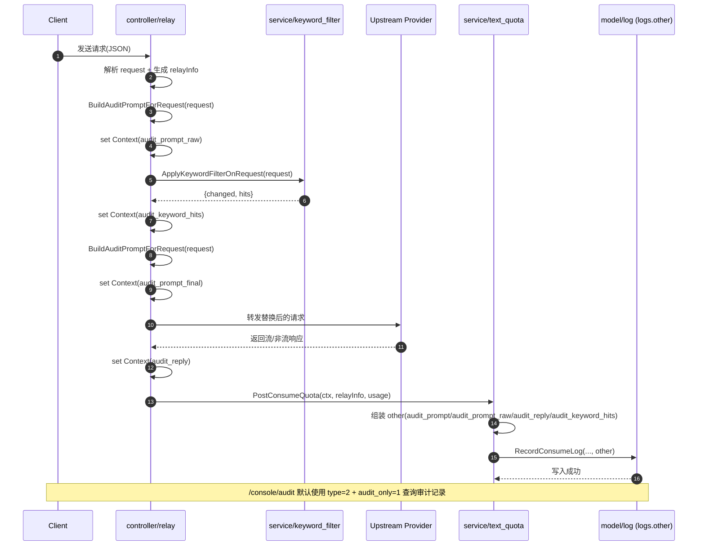

# SWS-11780 变更说明

## 1. 目标与背景

本次改动围绕以下诉求完成：

1. 修复前端构建在旧 Node 环境下失败（Vite 顶层 await 兼容性问题）。
2. 落地内容审计能力：记录并查看员工与大模型对话，支持关键词替换审计。
3. 将内容审计页面与使用日志页面区分开，提升可见性与可用性。
4. 支持关键词替换增强能力：
	- 不区分大小写；
	- 支持通配符；
	- 支持正则表达式。
5. 敏感词命中时返回明确提示，不再仅中断无提示。
6. 修复设置页“屏蔽词列表/关键词替换规则”输入框贴合显示问题。

---

## 2. 前端构建修复

### 2.1 变更内容

将前端脚本统一改为 Bun 运行时执行 Vite，规避系统旧 Node 对 Vite 5 的语法兼容问题。

### 2.2 涉及文件

- web/package.json

### 2.3 结果

- bun run build 可稳定通过。

---

## 3. 内容审计能力（后端）

### 3.1 审计字段采集与落库

在请求处理与计费日志阶段补充审计字段链路，落入消费日志 logs.other：

- audit_prompt（最终提问）
- audit_prompt_raw（替换前提问）
- audit_reply（回复内容）
- audit_keyword_hits（关键词命中）

### 3.2 审计字段来源改进（优先 user 内容）

新增按请求结构提取审计提问的逻辑，优先提取 user 文本，避免 system 超长内容占满截断长度导致看不到用户提问。

支持的请求类型：

- OpenAI 兼容请求
- Claude 请求
- Gemini 请求

### 3.3 查询能力增强

日志查询接口新增 audit_only 参数，支持仅返回包含审计内容的消费日志记录。

### 3.4 涉及文件

- constant/context_key.go
- controller/relay.go
- controller/log.go
- service/text_quota.go
- service/audit_prompt.go
- relay/channel/openai/relay-openai.go
- relay/channel/openai/chat_via_responses.go
- model/log.go

### 3.5 请求链路与写入时机（技术细节）

请求在中继入口的关键顺序如下：

1. 解析请求体并生成 request 对象。
2. 提取审计原始提问（audit_prompt_raw）。
3. 执行关键词替换（会改写 request 内文本字段）。
4. 再次提取替换后的审计提问（audit_prompt）。
5. 下游请求完成后收集回复文本（audit_reply）。
6. 在消费日志写入阶段统一落库到 logs.other。

审计写入采用“上下文透传 + 最终落库”模式：

- relay 阶段只做 context 设置，不直接写 DB。
- text_quota 结算阶段统一写入 other map，避免重复落库。

### 3.6 审计提问提取策略（技术细节）

新增的提问构造策略不是简单使用 CombineText，而是按请求结构分层提取并排序：

1. 优先 user 文本。
2. 其次 system/developer 文本。
3. 最后其他角色内容。

这样可避免 openclaw 场景下 system 过长导致 user 被截断看不到。

### 3.7 数据结构与存储（技术细节）

logs.other 为 JSON 字符串，审计相关键位如下：

```json
{
	"audit_prompt": "替换后提问文本",
	"audit_prompt_raw": "替换前提问文本",
	"audit_reply": "模型回复文本",
	"audit_keyword_hits": ["aaaa", "foo*bar"]
}
```

本次将 Log 模型中的 other 字段显式声明为 text，以降低长文本截断风险。

### 3.8 audit_only 过滤实现（技术细节）

控制器新增 query 参数：

- audit_only=1

模型查询层通过 other 字段关键字匹配过滤：

- 包含 "audit_prompt" 或 "audit_reply" 即视为审计记录。

该实现兼容 SQLite/MySQL/PostgreSQL（使用通用 LIKE 条件）。

### 3.9 审计与替换时序图（Mermaid）



---

## 4. 内容审计页面（前端）

### 4.1 页面与路由

新增独立审计页并接入路由，不再与使用日志完全复用同一页面行为。

- 路由：/console/audit（管理员可见）
- 页面：Audit 模式渲染 Usage Logs 组件

### 4.2 审计模式默认行为

审计模式下：

1. 默认 logType=2（消费日志）。
2. 自动附加 audit_only=1 查询参数。
3. 隐藏日志类型下拉，避免误切普通视图。
4. 默认展开可展开行，直接可见提问/回复。

### 4.3 审计可见性兜底

为 logs.other 解析失败场景增加兜底展示：

- 当 other JSON 解析失败时，展开区显示原始 other 文本；
- 解析器支持双重 JSON 字符串场景，提升兼容性。

### 4.4 涉及文件

- web/src/App.jsx
- web/src/pages/Audit/index.jsx
- web/src/components/table/usage-logs/index.jsx
- web/src/components/table/usage-logs/UsageLogsFilters.jsx
- web/src/components/table/usage-logs/UsageLogsTable.jsx
- web/src/hooks/usage-logs/useUsageLogsData.jsx
- web/src/helpers/log.js
- web/src/components/layout/SiderBar.jsx
- web/src/helpers/render.jsx
- web/src/hooks/common/useSidebar.js
- web/src/pages/Setting/Operation/SettingsSidebarModulesAdmin.jsx

### 4.5 审计模式参数收敛（技术细节）

审计模式在 hook 内做参数收敛，保证用户无法通过 UI 误切成普通日志模式：

1. 初始化 logType 固定为 2。
2. 请求 URL 自动追加 audit_only=1。
3. 重置动作后仍回到 logType=2。

### 4.6 展开区渲染与兜底（技术细节）

展开区优先显示以下字段：

1. 提问内容（audit_prompt）
2. 回复内容（audit_reply）
3. 关键词替换命中（audit_keyword_hits）
4. 替换前提问（audit_prompt_raw）

当 other JSON 解析失败时，新增“附加信息(解析失败)”直接展示原始 other 字符串，确保可排障、可追溯。

---

## 5. 关键词替换功能增强

### 5.1 新增能力

关键词替换规则支持以下模式（默认不区分大小写）：

1. 普通文本匹配
	- 示例：aaaa=>bbbb
	- 可命中 AAAA、Aaaa 等

2. 通配符匹配
	- * 匹配任意长度
	- ? 匹配单个字符
	- 示例：foo*bar=>baz

3. 正则匹配
	- 规则左侧以 re: 前缀表示正则
	- 示例：re:\\baaaa\\b=>bbbb

### 5.2 规则兼容性

- 对非法正则做容错跳过，不影响其他规则。
- 命中词列表保留原规则 from 值用于审计展示。

### 5.3 涉及文件

- service/keyword_filter.go
- setting/sensitive.go
- model/option.go
- web/src/pages/Setting/Operation/SettingsSensitiveWords.jsx

### 5.4 测试

新增关键单测覆盖：

- 大小写不敏感替换
- 通配符替换
- 正则替换

文件：

- service/keyword_filter_test.go

### 5.5 匹配算法细节

规则左侧 from 的解析优先级：

1. re: 前缀 -> 正则模式（自动追加 (?i) 实现不区分大小写）。
2. 含 * 或 ? -> 通配符模式（转换为正则后匹配）。
3. 其他 -> 普通文本模式（转义后按大小写不敏感匹配）。

说明：

- * 对应任意长度字符序列。
- ? 对应单个字符。
- 非法正则规则会被跳过，不阻断整体替换流程。

### 5.6 替换行为示例

```text
规则: aaaa=>bbbb
输入: "AAAA and aaAa"
输出: "bbbb and bbbb"

规则: foo*bar=>X
输入: "foo123bar"
输出: "X"

规则: re:\\b(id|sn)-\\d+\\b=>MASK
输入: "id-123 sn-88"
输出: "MASK MASK"
```

---

## 6. 敏感词命中响应优化

### 6.1 现状问题

命中敏感词时请求会被中断，但客户端感知不够明确。

### 6.2 优化方案

命中敏感词后返回明确提示文本：

- 内容包含敏感词，请检查后重试

并保持错误码：

- sensitive_words_detected

### 6.3 涉及文件

- controller/relay.go
- types/error.go（沿用既有错误码定义）

### 6.4 返回格式（技术细节）

命中敏感词时返回 400，OpenAI 风格错误体（示例）：

```json
{
	"error": {
		"message": "内容包含敏感词，请检查后重试",
		"type": "new_api_error",
		"param": "",
		"code": "sensitive_words_detected"
	}
}
```

并设置 skipRetry，避免重试链路继续消耗渠道。

---

## 7. 设置页面布局优化

### 7.1 问题

“屏蔽词列表”与“关键词替换规则”两个输入框视觉上过于贴近。

### 7.2 处理

- 为输入区域 Row 增加 gutter（横纵间距）。
- 中大屏改为 12/12 分栏，小屏单列换行。

### 7.3 涉及文件

- web/src/pages/Setting/Operation/SettingsSensitiveWords.jsx

---

## 8. 验证结果

已执行并通过：

1. go test ./service ./controller
2. bun run build
3. go build -o new-api

### 8.1 本次新增验证点

1. 大小写不敏感替换：aaaa 规则可命中 AAAA。
2. 通配符替换：foo*bar 与 ? 模式生效。
3. 正则替换：re: 规则生效且非法规则不影响其他规则。
4. 敏感词命中返回友好提示文本与 400 状态码。
5. 审计页默认仅显示消费日志且仅审计记录。

---

## 9. 配置与使用说明

### 9.1 关键词替换规则格式

一行一条：

- 原词=>替换词

示例：

```text
aaaa=>bbbb
foo*bar=>baz
re:\\b(abc|xyz)\\d{2}\\b=>MASK
```

### 9.2 内容审计查看

1. 管理员进入 /console/audit。
2. 页面默认只看消费日志与审计相关记录。
3. 展开行可查看提问内容、回复内容、命中关键词、替换前提问。

---

## 10. 已知注意事项

1. 新增审计字段只对改动后生成的新日志生效，历史日志可能不含审计字段。
2. 前端资源嵌入采用 go:embed，重新构建前端后需重新 go build 才会带入最新 dist。
3. logs.other 建议使用 text 存储以降低长文本截断风险（本次模型定义已显式声明）。
4. 通配符模式是“全量匹配替换”，若规则写得过宽（如 *abc*）可能替换范围较大，建议优先使用边界明确的正则。
5. 正则采用大小写不敏感模式，若需要区分大小写，建议通过更严格字符类实现等价约束。
