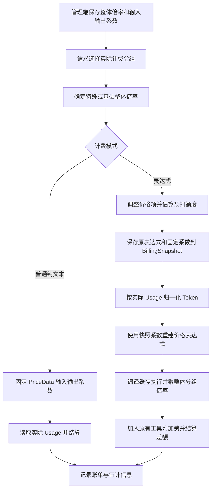

# 分组倍率改造：方案与技术实现

整理日期：2026-10-29。本文记录本次分组倍率改造的最终方案、实现边界和开发验证结果。

## 1. 背景与最终方案

原系统的 `GroupRatio` 是整体计费倍率：输入、输出等基础费用计算完成后，再使用实际生效的分组倍率计算费用。一个分组无法单独调整输入和输出折扣。

本次采用兼容扩展方案：

1. 保留原有整体倍率 `GroupRatio`，不改变它与特殊倍率规则的关系。
2. 新增输入系数 `GroupInputRatio` 和输出系数 `GroupOutputRatio`。
3. 普通纯文本 Token 计费的输入、缓存读取、缓存写入费用乘输入系数，输出费用乘输出系数。
4. 扩展表达式计费：文本及缓存价格项使用对应系数，显式媒体价格项保持原价。
5. 预扣费和结算使用请求开始时固定的系数，防止中途修改配置影响同一请求。
6. 配置默认均为 `1`，旧配置和旧计费快照保持兼容。

前端最终保留“倍率、输入系数、输出系数”三项。曾讨论仅显示输入倍率和输出倍率、自动反算底层配置，但该简化方案已取消，没有实施。

本次没有新增按用户分组分别配置输入、输出特殊系数的规则，也没有为原本不支持表达式的接口新增表达式入口。

## 2. 配置定义

| 配置项 | 含义 | 形式 | 缺省行为 |
| --- | --- | --- | --- |
| `GroupRatio` | 计费分组的整体倍率 | 分组名到数字的 JSON 对象 | 沿用原有逻辑 |
| `GroupInputRatio` | 文本输入及缓存费用的附加系数 | 分组名到数字的 JSON 对象 | 未配置分组为 `1` |
| `GroupOutputRatio` | 文本输出费用的附加系数 | 分组名到数字的 JSON 对象 | 未配置分组为 `1` |
| `GroupGroupRatio` | 用户分组使用目标分组时的特殊整体倍率 | 嵌套 JSON 对象 | 无规则时使用目标分组整体倍率 |
| `TopupGroupRatio` | 用户分组充值定价倍率 | 分组名到数字的 JSON 对象 | 本次不修改 |

示例配置：

```json
{
  "GroupRatio": {"default": 1, "vip": 0.5},
  "GroupInputRatio": {"vip": 0.5},
  "GroupOutputRatio": {"vip": 0.8}
}
```

以上是配置的语义展示；数据库中的每个选项值实际存储为 JSON 字符串，而不是一次写入上述整个对象。

输入、输出系数是整体倍率之外的附加系数。例如 VIP 的整体倍率为 `0.5`、输入系数为 `0.5`，文本输入的最终分组乘数为 `0.25`，不是 `0.5`。

### 2.1 校验规则

- 必须是 JSON 对象，不接受 `null` 或数组。
- 分组名不能是空字符串。
- 系数必须非负且有限，不接受负数、NaN 或 Infinity。
- 显式 `0` 是有效配置，不能被当成“未配置”回退为 `1`。
- `{}` 是合法配置，表示全部使用缺省系数。
- 当前不设新的系数硬上限，最终额度仍由既有额度转换与饱和机制保护。
- 校验失败时，不覆盖原有有效系数表。

### 2.2 存储与接口

新增选项直接使用 `GroupInputRatio`、`GroupOutputRatio`，不是 `group_ratio_setting.group_input_ratio` 等命名空间键。

它们复用既有 `options` 存储和选项更新接口，不新增数据库表或列，也不需要数据库迁移。

通过既有权限校验后的选项接口更新，例如：

```http
PUT /api/option/
Content-Type: application/json
```

```json
{
  "key": "GroupInputRatio",
  "value": "{\"vip\":0.5}"
}
```

内存中使用两个 `types.RWMap[string, float64]` 保存配置。读取函数为 `GetGroupTokenRatios(name)`，一次返回输入、输出系数。

## 3. 分组选择与特殊规则

系数按实际计费分组 `relayInfo.UsingGroup` 获取，不直接按账号的 `UserGroup` 获取。

```text
确定实际计费分组，包括 auto 分组选择
→ 查找 UserGroup → UsingGroup 的特殊整体倍率
→ 有特殊规则：用特殊倍率替换基础 GroupRatio
→ 无特殊规则：使用 UsingGroup 的 GroupRatio
→ 从 UsingGroup 读取输入、输出系数
→ 固定本次请求价格信息
```

特殊整体倍率是“替换”，不是“叠乘”。但输入、输出系数仍然叠加在实际生效的整体倍率上。

例如：目标分组基础倍率 `0.5`，特殊整体倍率 `0.7`，输入系数 `0.5`，则文本输入的最终分组乘数为 `0.7 × 0.5 = 0.35`，不是 `0.5 × 0.7 × 0.5`。

自动分组或重试选中新的计费分组时，由对应价格计算路径读取该分组配置；不要按最初令牌分组或仅按用户账号分组推断最终价格。

## 4. 最终生效范围

| 计费路径或项目 | 输入系数 | 输出系数 | 整体分组倍率 |
| --- | --- | --- | --- |
| 普通纯文本输入 Token | 使用 | 不使用 | 使用 |
| 普通纯文本输出 Token | 不使用 | 使用 | 使用 |
| 普通纯文本缓存读取、写入 | 使用 | 不使用 | 使用 |
| 非表达式的多模态混合请求 | 不使用 | 不使用 | 沿用原逻辑 |
| 表达式 `p` 价格项 | 使用 | 不使用 | 使用 |
| 表达式 `c` 价格项 | 不使用 | 使用 | 使用 |
| 表达式 `cr`、`cc`、`cc1h` 价格项 | 使用 | 不使用 | 使用 |
| 表达式显式图片、音频、时长、张数、字符价格项 | 不使用 | 不使用 | 使用 |
| 按次计费、普通音频或实时音频计费 | 不使用 | 不使用 | 沿用原逻辑 |
| 搜索等工具附加费用 | 不使用 | 不使用 | 沿用原逻辑 |
| 充值定价 | 不适用 | 不适用 | 使用其自身原有规则 |

判断标准是“本次请求实际使用的计费路径”，不是模型名称。

同一个支持图像的模型，只发纯文本并使用普通 Token 计费时，可以使用新系数；发图文混合请求且未启用表达式计费时，整笔仍按原规则处理，其中的文本部分也不应用新系数。

进入 `tiered_expr` 计费路径后，则按表达式变量区分文本、缓存和媒体费用，即使请求本身是多模态，也会调整表达式中的文本及缓存价格项。

## 5. 普通纯文本 Token 计费

设：

- `G`：实际生效的整体分组倍率。
- `M`：模型输入倍率 `ModelRatio`。
- `A`：分组输入系数。
- `B`：分组输出系数。
- `I`：按既有语义归一化后的纯文本输入及加权缓存 Token。
- `C`：输出 Token 数。
- `Rout`：模型输出倍率 `CompletionRatio`。

不考虑工具附加费、其他请求倍率与额度舍入时：

```text
quota = G × M × (A × I + B × C × Rout)
```

这里是普通模型倍率模式的内部额度公式，不要再照表达式模式额外乘一次 `QuotaPerUnit / 1000000`。

输入侧的缓存加权沿用原有逻辑：

```text
I = 纯文本输入 Token
    + 缓存读取 Token × 缓存读取倍率
    + 缓存写入 Token × 对应缓存写入倍率
```

Claude 的 5 分钟、1 小时缓存写入价格仍使用各自原有倍率，再统一应用输入系数。

OpenAI、Claude、OpenRouter 等上游的输入与缓存 Token 统计语义不同；本次不重写既有归一化规则，而是在归一化和缓存加权后应用输入系数，避免重复计费。

### 5.1 普通请求的识别与排除

预扣费通过 `isPlainTextTokenBilling(info, meta)` 判断是否固定新系数，主要排除：

- 请求元数据包含文件，或者 Token 类型为图片。
- 存在 ASR 输入时长、图片生成张数、视频时长、TTS 字符数。
- 实时音频、音频、图片、任务及 MJ 协议路径。
- OpenAI 请求声明了非文本 `modalities`。
- Gemini 请求声明了非文本 `responseModalities`。

结算时还有一道保护：若 Usage 中出现输入或输出图片、音频 Token，或者本次调用被标记为图像生成，则不应用普通文本的新系数。

上述判断是基于请求元数据和上游 Usage 的识别结果，不是按模型能力标签推断。

### 5.2 预扣费

普通文本请求启用非默认系数时，预扣估算为：

```text
estimated_input = max(输入估算 Token, common.PreConsumedQuota)
estimated_output = 客户端输出上限，或缺省估算

pre_quota = M × G × (
  estimated_input × A
  + estimated_output × CompletionRatio × B
)
```

未提供输出上限且输出系数大于 `0` 时，使用现有 `8192` Token 缺省估算值。它是预扣估算，不是强制修改客户端的最大输出 Token。

输入、输出系数均为 `1` 时，保持原有普通模式预扣公式，不顺带改变旧请求的预扣策略。

预扣不是最终收费，最终按实际 Usage 结算差额。缓存和媒体等缺少实际 Usage 的维度，预扣阶段不等于最终费用精确拆分。

### 5.3 零系数与最低额度

- 输入系数 `0`：普通纯文本输入及缓存费用为零，输出仍按自己的系数收费。
- 输出系数 `0`：普通纯文本输出费用为零，输入及缓存仍收费。
- 两项均为 `0`：普通文本 Token 费用为零，不再因原有最低额度保护被收取 `1` 点。
- 两项均为 `0` 不代表工具调用免费，也不代表表达式中的媒体或固定费用免费。
- 其他最低额度、无 Usage、零 Token 等行为仍沿用对应路径的既有规则。

## 6. 表达式计费

### 6.1 为什么不能直接缩放 Token 数

不能简单把运行环境中的 `p` 改成 `p × A`、把 `c` 改成 `c × B`。

例如原条件是 `p > 200000`，若把 `p` 乘以 `0.5` 后再判断，本来属于长上下文档位的请求可能被误判成短上下文档位。

最终实现调整的是价格项，条件判断仍使用原始归一化 Token 数和上下文长度。

### 6.2 变量对应关系

| 变量 | 含义 | 应用系数 |
| --- | --- | --- |
| `p` | 未被单独计价的输入 Token | 输入系数 |
| `cr` | 缓存读取 Token | 输入系数 |
| `cc` | 通用或 5 分钟缓存写入 Token | 输入系数 |
| `cc1h` | 1 小时缓存写入 Token | 输入系数 |
| `c` | 未被单独计价的输出 Token | 输出系数 |
| `img`、`img_o` | 图片输入、输出 Token | 不应用新系数 |
| `ai`、`ao` | 音频输入、输出 Token | 不应用新系数 |
| `asr_s` | ASR 输入音频时长 | 不应用新系数 |
| `img_n`、`vid_s` | 图片生成张数、视频时长 | 不应用新系数 |
| `tts_c` | TTS 输入字符计价量 | 不应用新系数 |
| `len` | 完整输入上下文长度，通常用于档位判断 | 不缩放 |

“媒体价格不变”指显式独立计价的媒体项。如果表达式没有使用某个媒体变量，对应 Token 仍按原归一化规则留在 `p` 或 `c` 中，会跟随该兜底项的系数。

缓存同理：若没有独立使用 `cr` 等变量，对应缓存 Token 仍按表达式既有兜底规则计费，不会凭空产生独立缓存价格。

### 6.3 用户示例与完整计算

基础表达式：

```text
tier("base", p * 2 + c * 8 + img * 2.5 + img_o * 1)
```

输入系数 `0.5`、输出系数 `0.8` 时，其计费效果等价于：

```text
tier("base", p * 2 * 0.5 + c * 8 * 0.8 + img * 2.5 + img_o * 1)
```

也就是文本输入单价变为 `1`、文本输出单价变为 `6.4`，图片输入仍为 `2.5`、图片输出仍为 `1`，单位仍是美元/百万 Token。

假设归一化后 `p=1000`、`c=200`、`img=100`、`img_o=50`，整体分组倍率为 `0.5`：

```text
文本输入价格项 = 1000 × 2 × 0.5 = 1000
文本输出价格项 = 200 × 8 × 0.8 = 1280
图片输入价格项 = 100 × 2.5 = 250
图片输出价格项 = 50 × 1 = 50

表达式结果 = 1000 + 1280 + 250 + 50 = 2580
基础美元费用 = 2580 / 1000000 = 0.00258
乘整体分组倍率后 = 0.00258 × 0.5 = 0.00129 美元

若 QuotaPerUnit = 500000：
最终内部额度 = round(0.00129 × 500000) = 645
```

缓存价格项的写法例如：

```text
tier("base", p * 2 + c * 8 + cr * 0.2 + cc * 2.5 + cc1h * 4)
```

其中 `p`、`cr`、`cc`、`cc1h` 的价格项使用输入系数，`c` 的价格项使用输出系数。

### 6.4 AST 转换实现

入口为 `billingexpr.ApplyGroupTokenRatios(expression, inputRatio, outputRatio)`。

转换使用项目已有的 `expr-lang/expr` 解析器和 AST，不使用正则替换表达式字符串：

1. 校验输入、输出系数非负且有限。
2. 两项均为 `1` 时，直接返回原表达式，保证默认兼容。
3. 解析表达式，处理并保留 `v1:` 版本前缀。
4. 遇到条件表达式，只递归处理两侧结果分支，保留条件本身。
5. 遇到 `tier(name, price)`，保留档位名称，只处理价格参数。
6. 对加减价格项分别递归处理。
7. 仅依赖输入/缓存维度的价格项，整体乘输入系数；仅依赖输出维度的价格项，整体乘输出系数。
8. 仅包含媒体维度或没有 Token 维度的固定价格项，保持不变。
9. 混合价格项外部的独立公共标量乘数或除数，可以保留，再递归处理内部价格项。
10. 无法明确分离输入、输出、媒体费用的混合项，返回错误，不猜测收费规则。

例如 `(p * 2 + c * 8 + img * 2.5) * 2` 可以逐项调整后继续乘公共倍率 `2`。

仅属于输入维度的非线性价格项，例如 `max(p - 100, 0) * 2`，是对整个输入价格项乘系数，不把内部的免费 Token 阈值 `100` 改掉。

### 6.5 限制与错误行为

本实现不是任意复杂表达式的自动费用归因系统。

以下示例在配置非默认系数时不能明确拆分：

```text
tier("base", p * c)
tier("base", p * img)
tier("base", max(p * 2 + c * 8, 10))
```

这种情况下应改写为明确的独立输入、输出、媒体价格项。仅仅因为表达式语法有效，不代表它可以在不同系数下自动归因。

两项系数均为 `1` 时不做转换，保持原表达式兼容，不增加上述分项限制。

价格转换或预扣阶段计算失败时，价格辅助函数返回错误，不以猜测结果继续计费。

进入结算后，若表达式运行失败，`TryTieredSettle` 沿用既有降级策略：优先使用 `FinalPreConsumedQuota`，否则使用快照中的 `EstimatedQuotaAfterGroup`。

对于非默认系数的调整结果，额外拒绝负费用和 NaN，避免差异化系数使原表达式产生负扣费。正向超大结果仍走既有额度饱和机制。

## 7. 预扣、快照、结算与编译缓存



### 7.1 普通模式

`types.PriceData` 新增：

```go
GroupInputRatio  *float64
GroupOutputRatio *float64
```

使用指针区分“未应用/旧数据”和“显式零系数”。没有固定新系数的普通请求，结算时默认采用 `1/1`。

### 7.2 表达式模式

`billingexpr.BillingSnapshot` 新增：

```go
GroupInputRatio  *float64 `json:"group_input_ratio,omitempty"`
GroupOutputRatio *float64 `json:"group_output_ratio,omitempty"`
```

快照仍保存原始 `ExprString`、原始 `ExprHash`、整体 `GroupRatio`、估算 Token、预扣额度、档位、表达式版本及 `QuotaPerUnit`。

预扣阶段读取实际计费分组的系数，使用转换后的表达式计算估算费用，再把原表达式和系数固定到快照。

结算阶段从快照读取系数，重新构建同一价格规则，不重新读取分组配置。旧快照的新字段为空时，按 `1/1` 处理。

若转换后表达式与原表达式不同，则为转换后字符串计算新的哈希，以既有编译缓存执行，避免把不同系数的编译程序混用。没有新增表达式运行环境变量，也不修改模型保存的基础表达式。

### 7.3 Token 归一化与额度转换

`BuildTieredTokenParams` 的既有语义保持不变：

- OpenAI 类总 Token 统计中，只有表达式独立使用某个子类别变量时，才从 `p` 或 `c` 中扣除该子类别。
- Claude 类纯文本输入统计遵循已有上游语义，不重复减去缓存。
- `len` 反映完整输入上下文长度，不受输入系数影响。

表达式额度转换仍为：

```text
quota_before_group = adjusted_expr_result / 1000000 × QuotaPerUnit
final_quota = QuotaRoundChecked(quota_before_group × GroupRatio)
```

合并工具附加费时使用已有 `composeTieredTextQuota` 路径，工具费不乘新增系数。不要再对整个表达式结果统一乘一次输入或输出系数。

## 8. 日志、前端与安全

### 8.1 日志字段

普通文本及表达式账单记录生效系数：

```json
{
  "group_ratio": 0.5,
  "group_input_ratio": 0.5,
  "group_output_ratio": 0.8
}
```

表达式日志继续使用：

- `billing_mode = "tiered_expr"`。
- `expr_b64`：原基础表达式的 Base64 编码，不是写回模型配置的折扣表达式。
- `matched_tier`：实际命中档位；降级时沿用既有快照档位记录规则。

`InjectTieredBillingInfo` 从快照写入生效系数。账单详情可以显示表达式的输入、输出系数，缺省 `1` 不额外显示倍率行。

### 8.2 前端配置

- 分组定价表保留整体倍率，并新增输入系数、输出系数两列。
- 新分组两项系数默认 `1`，旧分组缺省展示为 `1`。
- 可视化模式、JSON 模式、详情抽屉和保存流程均支持两项配置。
- 可视化编辑改名或删除分组时，系数随对应行序列化处理。
- 默认系数 `1` 可以不显式写入映射，避免制造大量冗余配置。
- 负数等非法配置会阻止表单保存，后端同时校验，不能只信任页面输入框。
- 模型表达式编辑器预览仍显示基础表达式，不绑定某个特定分组的折扣。

输入系数、输出系数及校验提示已覆盖 `en`、`zh`、`zh-TW`、`fr`、`ja`、`ru`、`vi` 七种语言。语言文件通过既有翻译脚本及 `i18n:sync` 更新。

### 8.3 额度安全

- 继续使用 `common.QuotaFromFloat`、`common.QuotaFromDecimalChecked`、`common.QuotaRoundChecked` 等集中转换函数，不新增裸 `int` 转换。
- 额度按既有数据库兼容的 int32 边界饱和，超大正额度不能溢出成负数。
- 结算饱和事件通过 `TieredResult.Clamp` 和 `noteQuotaClamp` 进入既有请求审计链路。
- 既有消费日志审计标记位于 `other.admin_info.quota_saturation`，不增加普通用户可见的管理审计信息。
- 两项新系数为零不绕过原有工具费、媒体费或独立固定价格项。

## 9. 主要代码位置

下列链接相对本文所在的 `docs` 目录。

| 位置 | 本次职责 |
| --- | --- |
| [setting/ratio_setting/group_ratio.go](../setting/ratio_setting/group_ratio.go) | 系数表、默认值、JSON 校验、读取与更新 |
| [model/option.go](../model/option.go) | 选项初始化、读取和更新接入 |
| [controller/option.go](../controller/option.go) | 新选项的请求校验 |
| [types/price_data.go](../types/price_data.go) | 普通请求的固定系数字段 |
| [relay/helper/price.go](../relay/helper/price.go) | 实际分组倍率、普通预扣、表达式预扣和快照 |
| [service/text_quota.go](../service/text_quota.go) | 普通文本/缓存结算、多模态排除、工具费合并、零系数保护 |
| [service/tiered_settle.go](../service/tiered_settle.go) | 既有 Usage 归一化、表达式结算及失败降级 |
| [pkg/billingexpr/group_token_ratios.go](../pkg/billingexpr/group_token_ratios.go) | AST 价格项转换 |
| [pkg/billingexpr/types.go](../pkg/billingexpr/types.go) | 表达式快照系数字段 |
| [pkg/billingexpr/settle.go](../pkg/billingexpr/settle.go) | 固定系数执行、哈希选择和负费用保护 |
| [service/log_info_generate.go](../service/log_info_generate.go) | 表达式日志系数注入 |
| [pkg/billingexpr/expr.md](../pkg/billingexpr/expr.md) | 表达式计费的完整设计与变量语义 |

前端主要接入位置：

- [group-ratio-visual-editor.tsx](../web/default/src/features/system-settings/models/group-ratio-visual-editor.tsx)：表格列、行序列化和详情。
- [group-ratio-form.tsx](../web/default/src/features/system-settings/models/group-ratio-form.tsx)：可视化与 JSON 编辑、保存保护。
- [ratio-settings-card.tsx](../web/default/src/features/system-settings/models/ratio-settings-card.tsx)：schema、默认值、重置和保存参数。
- [billing/section-registry.tsx](../web/default/src/features/system-settings/billing/section-registry.tsx)：分组定价入口默认值。
- [system-settings/types.ts](../web/default/src/features/system-settings/types.ts)：共享配置类型。
- [usage-logs/types.ts](../web/default/src/features/usage-logs/types.ts)：新增日志字段类型。
- [details-dialog.tsx](../web/default/src/features/usage-logs/components/dialogs/details-dialog.tsx)：账单生效系数显示。
- [add-missing-keys.mjs](../web/default/scripts/add-missing-keys.mjs)：`--group-token-ratios` 定向翻译写入。

相关设置页面和模型抽屉的默认值也补齐了新增字段，没有修改已有品牌、署名和版权头。

## 10. 测试与验证记录

### 10.1 回归测试位置

| 测试文件 | 保护的行为 |
| --- | --- |
| [group_ratio_test.go](../setting/ratio_setting/group_ratio_test.go) | 缺省 `1`、显式 `0`、非法 JSON/负数拒绝、有效配置不被覆盖 |
| [price_test.go](../relay/helper/price_test.go) | 普通预扣、自动分组、多模态排除、缺省输出估算、表达式快照冻结及序列化 |
| [text_quota_test.go](../service/text_quota_test.go) | 普通输入/输出/缓存折扣、零系数、工具费独立性、媒体与缓存 Usage 拆分、日志标记 |
| [group_token_ratios_test.go](../pkg/billingexpr/group_token_ratios_test.go) | AST 转换、图片与缓存示例、条件不变、媒体单位、默认兼容、混合项拒绝、负费用与饱和 |
| [settle_clamp_test.go](../pkg/billingexpr/settle_clamp_test.go) | 既有表达式结算额度溢出饱和契约 |

### 10.2 最近一次开发验证

以下是开发期间已执行的验证记录，不代表每次阅读本文都重新执行了这些命令。

- 表达式引擎包和价格辅助包完整测试通过。
- 文本、缓存、阶梯结算和新增表达式系数的相关回归测试通过。
- 修改前端文件的局部 lint 通过，前端生产构建通过。
- 新增词条在七种语言中完整，受保护版权头未改变。
- 普通系数页面的浏览器检查覆盖默认值、零值、负数禁用保存、JSON 模式切换、保存参数，以及桌面/手机宽度。
- 上述浏览器保存检查使用模拟 API，只验证前端交互，不等同真实数据库写入或真实上游端到端计费测试。

完整检查中的既有问题没有在本次改造中修复：

- 最近一次前端全量类型检查仍有 13 个错误，位于未修改的其他功能模块；本次新增字段的类型错误已消除。
- 曾运行完整 `service` 包测试，路由协议测试 `TestRoutingFeaturesProtocols` 期望 5 个协议、实际返回 8 个而失败；本次计费相关回归通过，该无关路由测试未被修改。

### 10.3 可复验命令

在仓库根目录：

```bash
go test ./setting/ratio_setting -count=1
go test ./pkg/billingexpr ./relay/helper -count=1
go test ./service -run 'Test(CalculateText|TryTiered|BuildTiered|Tiered|ComposeTiered)' -count=1
git diff --check
```

在前端目录：

```bash
cd web/default
bun run oxlint -c .oxlintrc.json src/features/usage-logs/components/dialogs/details-dialog.tsx
bun run build
bun run typecheck
```

需要重写本次翻译词条时，使用项目既有脚本，不手工修改语言 JSON：

```bash
cd web/default
bun scripts/add-missing-keys.mjs --group-token-ratios
bun run i18n:sync
```

## 11. 部署、兼容与运维建议

1. 后端需要重新编译并重启，或者发布包含这些改动的新镜像；只刷新前端不会使新计费逻辑生效。
2. 前端需要构建并发布匹配版本，否则可能没有新系数配置入口或账单显示。
3. 不需要数据库迁移，也不需要为系数新增 Docker Compose 环境变量。
4. 先保持两项系数为 `1` 验证基线，再逐个分组调整，核对普通文本、缓存、表达式与媒体账单。
5. 配置前检查自定义表达式是否含无法拆分的输入/输出/媒体混合项，避免请求在价格计算阶段被拒绝。
6. 从老版本升级时，已在运行中的旧请求或旧任务快照缺少系数字段，仍按旧快照的 `1/1` 语义结算。
7. 在新版逻辑下把系数设回 `1/1`，可以恢复不附加输入、输出折扣的规则，但不会追溯修改历史账单。
8. 不建议在仍有新版本请求或任务运行时直接降级旧二进制；旧版本不理解新增快照系数，可能导致进行中的请求结算口径变化。

最终约定是：模型配置定义基础价格，分组整体倍率决定统一折扣，输入、输出系数决定可分离文本与缓存价格项的额外折扣，媒体独立价格和工具费不受新增系数影响。