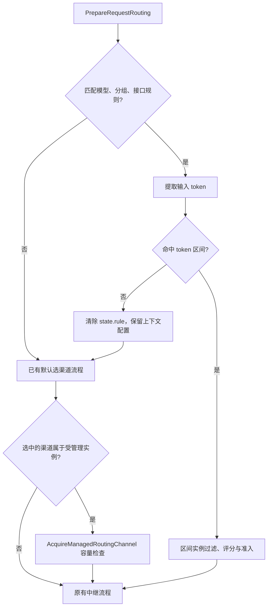

# SWS-12881：规则型路由提交与未覆盖区间回退说明

整理日期：2026-10-29。

本文记录 new-api 的输入 token 区间路由方案、原始提交，以及后续“未覆盖区间走默认渠道”的修复细节。原始提交与修复后的行为分别说明，避免将历史方案当作当前行为。本文不涉及日志存储、ClickHouse TTL 或其他功能的修改。

## 1. 依据与结论

| 项目 | 内容 |
| --- | --- |
| 需求 | SWS-12881，按输入长度配置渠道规则 |
| 原始提交 | `a0feb481519cbfedfd85f75b47ec3480b64c03b6` |
| 提交标题 | `feat(SWS-12881): 新增规则性路由，可根据输入长度配置渠道规则` |
| 提交作者 | zhaoling |
| 提交日期 | 2026-10-12 |
| 提交规模 | 31 个文件，3191 行新增、678 行删除；包含前端翻译等配套变更，不等于路由核心代码规模 |
| 参考方案 | [TecoAPI 网关规则型路由机制](https://alidocs.dingtalk.com/i/nodes/P7QG4Yx2Jprv9BYzHqODRnjMW9dEq3XD) |
| 当前功能说明 | [request-routing.md](request-routing.md) |

**修复后的结论：请求匹配了模型、分组和接口规则，但输入 token 数未被任何区间覆盖时，不再返回 `routing_token_range_uncovered`，而是继续执行已有默认渠道选择逻辑。**

“默认渠道”不是指定某个固定渠道，也不是固定使用名为 `default` 的分组；它指请求原本应走的默认分发流程，沿用请求的模型、授权分组、渠道优先级、亲和性及已有重试规则。

这不是“所有规则路由错误均自动降级”。已命中区间后的实例满载、无合规实例或 Redis 不可用仍按原有策略报错。

## 2. 原始提交的功能方案

### 2.1 目标与适用范围

同一个请求模型可按输入 token 长度进入不同实例池，减少不同长度请求之间的资源竞争。路由只选择渠道，不自动改为其他模型，也不改变原有计费分组和计费逻辑。

支持同步文本请求：

- `POST /v1/chat/completions`
- `POST /pg/chat/completions`
- `POST /v1/messages`
- `POST /v1/responses`

功能默认关闭。管理员入口为“系统设置 → 模型设置 → 请求路由”。规则支持多个模型、多个分组、多个 token 区间和每个区间的实例池。分组留空表示匹配全部使用分组，不表示放宽权限。

### 2.2 提交涉及的主要实现

| 实现位置 | 职责 |
| --- | --- |
| [controller/option.go](../controller/option.go) | 路由配置保存、校验及版本处理 |
| [setting/operation_setting/request_routing.go](../setting/operation_setting/request_routing.go) | 配置结构、区间与实例约束、旧配置兼容 |
| [middleware/distributor.go](../middleware/distributor.go) | 分发前准备规则、对接默认选渠道、受管理实例准入与释放 |
| [service/request_routing.go](../service/request_routing.go) | 输入特征提取、区间匹配、实例评分、容量预留和释放 |
| [service/channel_select.go](../service/channel_select.go) | 根据规则激活状态选择规则分发或默认分发 |
| [controller/relay.go](../controller/relay.go) | 中继流程中的路由配合 |
| [service/log_info_generate.go](../service/log_info_generate.go) | 将路由决策写入管理员日志信息 |
| [service/request_routing_test.go](../service/request_routing_test.go) | 输入特征、实例选择、容量、并发及后续回退回归测试 |
| [setting/operation_setting/request_routing_test.go](../setting/operation_setting/request_routing_test.go) | 配置校验测试 |
| [test/test_routing_tokens.py](../test/test_routing_tokens.py) | token 路由相关验证脚本 |
| [request-routing.md](request-routing.md) | 功能、限制和验证说明 |

前端主要变更位于 [request-routing-section.tsx](../web/default/src/features/system-settings/models/request-routing-section.tsx)、[request-routing-rule-list.tsx](../web/default/src/features/system-settings/models/request-routing-rule-list.tsx)、[request-routing-rule-editor.tsx](../web/default/src/features/system-settings/models/request-routing-rule-editor.tsx) 和 [request-routing-schema.ts](../web/default/src/features/system-settings/models/request-routing-schema.ts)，配套修改系统设置注册、组件及多语言文件。

规则列表支持搜索、区间与渠道展示、详情及新增/编辑抽屉；新增、修改、删除确认和总开关直接保存，JSON 模式保留显式保存动作。失败时保留草稿，取消不提交。

### 2.3 配置结构与约束

管理员配置键为 `RequestRouting`，核心层级为 `rules → ranges → instances`。

| 字段 | 含义 |
| --- | --- |
| `enabled` | 是否启用规则路由 |
| `rules[].id` | 唯一且非空的规则名称/标识 |
| `models` | 请求模型名称列表 |
| `groups` | 使用分组列表；空列表匹配全部分组 |
| `ranges[].min_tokens` | 区间下限，包含该值 |
| `ranges[].max_tokens` | 区间上限，不包含该值；缺省或 null 表示不限 |
| `instances[].instance_id` | 独立推理实例标识 |
| `channel_ids` | 到达该实例的渠道或渠道别名 |
| `max_inflight` | 并发上限；缺省或 0 表示不限 |

区间允许不连续，但禁止重叠。模型、分组、接口匹配范围冲突的规则也会被拒绝；未覆盖区间并不意味着继续尝试另一条具有相同匹配范围的规则。

同一实例不能跨多个区间池或规则池配置，同一渠道不能归属不同实例。实例别名共享容量；`instance_id` 应对应真实独立的推理实例，不能把同一个上游共享负载均衡入口误认为多个独立容量池。

配置最大 256 KiB，最多 100 条规则，每条规则最多 100 个区间，每个区间最多 100 个实例，每个实例最多 100 个渠道。有限区间边界不得超过 10000000，`max_inflight` 最大为 10000。

四个支持接口由配置解析统一纳入，管理员无需选择接口。旧的 `input_token_threshold`、`short_pool`、`long_pool` 在读取时转为区间；实际配置状态后端固定为 Redis，版本由服务端保存时生成。

### 2.4 token 估计与负载选择

原始提交已经使用各协议 DTO 的 `GetTokenCountMeta()` 和项目 `CountTextToken`，不是简单地用请求字节数代替 token 数。计算口径为 `project-token-counter-v1`，不依赖计费 token 计数开关。

估计值包含文本 token、消息数量乘 3、名称数量乘 3、工具数量乘 8，以及固定 3 token 开销。部分工具调用、函数调用和 Responses 输入项会补充到计数文本中。未知编码使用项目既有回退策略；估计值并不保证与上游实际 usage 完全一致。

`work` 只取输入 token 估计数，输出 token 上限不参与路由负载评分。输入字段序列化总大小还会做 10000000 字节上限检查；这是输入大小限制，不是用字节数进行区间分类。

命中区间后，候选实例先过滤渠道状态、模型、授权分组、指定渠道及必要的请求路径支持情况，再进行负载评分：

```text
work_score = (当前实例在途输入 work + 本次输入 work) / WorkCapacity
有并发上限时：score = max(work_score, (当前在途数 + 1) / max_inflight)
无并发上限时：score = work_score
```

实际配置中 `WorkCapacity` 内部固定为 100000，不作为管理员调参项。排序优先保留渠道优先级，同优先级时选择较低 score；近似最优且同优先级的亲和渠道可被优先使用，阈值为最优 score 的 1.05 倍。并列候选先随机打散。

### 2.5 容量与可观测性

Redis 使用 `teco:routing:{instance_id}:attempts` 保存每个 attempt 的 work。Lua 脚本原子检查并发上限并写入预留；释放使用 `HDEL`。没有配置并发上限时仍记录负载，因此受管理实例仍需要 Redis。

容量保持到上游 attempt 的中继处理结束，不在第一个流式事件时提前释放。首次中继可复用已经取得的预留，重试前释放旧预留，释放操作幂等。

命中区间时写入响应头 `X-Teco-Routing-Version`、`X-Teco-Routing-Class`、`X-Teco-Routing-Count-Mode`。决策信息包括规则、区间、输入估计、实例、渠道、attempt 和 score；后台记录选路日志，管理员消费日志记录最终决策。

## 3. 未覆盖区间问题

### 3.1 原有行为与根因

`PrepareRequestRouting` 先按模型、分组和接口匹配规则，再提取 token 数，最后遍历规则区间。

原来的判断为：

```go
if len(state.pool) == 0 {
    return &RoutingError{http.StatusBadRequest, "routing_token_range_uncovered"}
}
```

匹配规则不等于匹配区间。配置允许区间存在空隙，但请求落入空隙时 `state.pool` 为空，直接返回 HTTP 400，分发中间件随即终止，因此无法进入后续默认渠道逻辑。

历史参考方案也明确描述了这一拒绝策略。后续需求将它调整为：未覆盖的输入长度继续默认分发。

### 3.2 行为对照

| 场景 | 原始提交 | 修复后 |
| --- | --- | --- |
| 功能关闭或未匹配规则 | 默认分发 | 不变 |
| 匹配规则且 token 命中区间 | 在区间池内选渠道 | 不变 |
| token 小于所有区间下限 | 400，`routing_token_range_uncovered` | 默认分发 |
| token 落在区间间隙 | 400，`routing_token_range_uncovered` | 默认分发 |
| token 等于有限上限，且无其他区间接收 | 400，`routing_token_range_uncovered` | 默认分发 |
| 命中区间但合规实例全部满载 | 429，`routing_capacity_exhausted` | 不变，不跨区间回退 |
| 命中区间但没有合规实例 | 503，`routing_no_available_instance` | 不变 |
| 需要访问实例状态但 Redis 不可用 | 503，`routing_state_unavailable` | 不变 |
| 配置非法 | 503，`routing_configuration_invalid` | 不变 |

未覆盖区间回退仍可能因默认渠道不可用、权限限制或受管理实例满载而失败；取消区间错误不代表保证请求成功。

## 4. 修复实现细节

### 4.1 修改规则激活状态

修复仅在未找到区间池时清除 `state.rule`，保留配置和请求状态，并正常返回：

```diff
 if len(state.pool) == 0 {
-    return &RoutingError{http.StatusBadRequest, "routing_token_range_uncovered"}
+    state.rule = nil
+} else {
+    c.Header("X-Teco-Routing-Version", config.Version)
+    c.Header("X-Teco-Routing-Class", state.class)
+    c.Header("X-Teco-Routing-Count-Mode", "project-token-counter-v1")
 }
-c.Header("X-Teco-Routing-Version", config.Version)
-c.Header("X-Teco-Routing-Class", state.class)
-c.Header("X-Teco-Routing-Count-Mode", "project-token-counter-v1")
```

函数末尾仍执行 `c.Set(routingContextKey, state)`。`RequestRoutingActive` 通过上下文状态存在且 `state.rule != nil` 判断规则是否激活，因此回退请求的规则激活状态为 false。

### 4.2 复用默认调用链



图中省略特征提取、选渠道及容量检查的错误出口；这些错误不会被本次修复统一转为默认分发。

`CacheGetRandomSatisfiedChannel` 在规则未激活时执行已有默认分发。分发中间件中的普通亲和性逻辑也因此恢复；已有模型权限、分组过滤、渠道优先级、自动分组和重试策略无需另写一套。

保留上下文很重要：默认选渠道后，`AcquireManagedRoutingChannel` 仍可遍历配置。如果默认选中的渠道属于受管理实例，仍登记输入负载并执行该实例并发上限，防止回退流量绕过共享容量。

重复调用 `PrepareRequestRouting` 时，已存在的上下文使其直接返回，避免回退请求再次分类。

### 4.3 响应头与限制

只有命中区间才写规则决策响应头。回退请求不写上述三个 `X-Teco-Routing-*` 头，也不生成区间选路决策，避免客户端误判为已经执行规则路由。

回退之前仍需成功完成输入特征提取。非法 JSON、多模态输入、Responses 历史/会话引用、后台执行、存储 prompt 引用等原有不支持场景不会因为“未覆盖区间回退”而自动获得支持。输入过大等错误也不被吞掉。

### 4.4 修复文件范围

后续回退修复涉及三个文件，未新增配置项，也不需要数据库迁移或前端表单变更：

- [service/request_routing.go](../service/request_routing.go)：未匹配区间时取消规则激活，命中区间才写响应头。
- [service/request_routing_test.go](../service/request_routing_test.go)：新增 `TestRequestRoutingTokenRangeFallback`。
- [request-routing.md](request-routing.md)：将未覆盖长度报错说明改为默认分发，并说明受管理实例容量约束仍生效。

## 5. 配置与边界示例

以下示例仅配置短请求与长请求；`[10000, 50000)` 留给默认分发。渠道 ID 和模型名需替换为实际配置，实例标识需与真实物理实例对应。

```json
{
  "enabled": true,
  "rules": [
    {
      "id": "model-length-routing",
      "models": ["model-a"],
      "groups": [],
      "ranges": [
        {
          "min_tokens": 0,
          "max_tokens": 10000,
          "instances": [
            {
              "instance_id": "model-a-short-1",
              "channel_ids": [101],
              "max_inflight": 8
            }
          ]
        },
        {
          "min_tokens": 50000,
          "instances": [
            {
              "instance_id": "model-a-long-1",
              "channel_ids": [102],
              "max_inflight": 4
            }
          ]
        }
      ]
    }
  ]
}
```

| 输入 token 估计数 | 修复后选路 |
| --- | --- |
| 9999 | 短区间，渠道 101 对应实例 |
| 10000 | 默认分发，短区间上限不包含此值 |
| 30000 | 默认分发，处于区间间隙 |
| 49999 | 默认分发 |
| 50000 | 长区间，渠道 102 对应实例 |
| 大于 50000 且通过请求校验 | 长区间，上限未配置 |

默认分发不自动排除 101 或 102。它仍可按原有条件选择这些渠道；若选中，则继续执行对应实例的容量检查。需要物理隔离时，管理员仍须合理配置分组、渠道能力及资源布局。

## 6. 回归测试与验证记录

### 6.1 新增测试设计

`TestRequestRoutingTokenRangeFallback` 覆盖四个接口，每个接口覆盖六种情况，共 24 个场景：低于下限、区间间隙、等于排他上限、等于包含下限、区间内部和无上限区间。

测试先调用项目 `routingFeatures` 得到输入 token 数，再据此构造边界，不写死不同协议的 token 结果。对回退场景验证：准备函数不返回错误；重复准备不改变状态；规则未激活；不写路由响应头；实际默认选渠道得到夹具中的渠道 101；保留请求分组；非受管理渠道准入不报错。

命中场景验证规则仍激活并保留分类响应头。原有容量与并发测试继续保护区间池选择、满载不跨池、预留复用和幂等释放。

测试显式初始化并恢复 `common.OptionMap`、数据库和缓存状态，使用邻近测试已有的 SQLite 与渠道缓存夹具。这样避免 nil map 写入 panic 及清理锁等待，也避免默认数据库选择依赖未初始化的方言列名。断言使用 `require` 和 `assert`。

### 6.2 历史验证结果

以下记录来自 2026-10-14 的回退修复会话，不表示 2026-10-29 在当前包含其他工作区修改的代码上重新执行了 Go 测试。

| 验证项 | 当时结果 |
| --- | --- |
| 新增 `TestRequestRoutingTokenRangeFallback` | 通过，覆盖四接口回退及边界 |
| 原有实例池选择、容量、并发和释放测试 | 通过 |
| `setting/operation_setting` 路由相关测试 | 通过 |
| `git diff --check` | 通过 |
| 完整路由相关测试集合 | 未全部通过：原有 `TestRoutingFeaturesProtocols` 计数断言期望 5，实际 8 |

该既有断言失败未在区间回退修复中修改，不能把整个测试集合描述为全部通过。多网关 Redis、真实上游和流式生命周期也不能仅凭这些单元测试声称已完成生产验证。

复现命令，在仓库根目录执行：

```sh
go test ./service -run '^TestRequestRoutingTokenRangeFallback$' -count=1 -timeout=60s
go test ./service ./setting/operation_setting -run 'Test(RequestRouting|Routing)' -count=1 -timeout=60s
git diff --check
```

## 7. 部署与运行注意事项

- 部署需包含后续回退修复；仅部署原始提交仍是未覆盖长度返回 400 的策略。
- 修复无需补齐所有 token 区间，但必须保证默认分发路径有符合模型和分组权限的可用渠道。
- Redis 不可用时，回退到普通非受管理渠道不需要路由状态；回退后选中受管理实例则仍可能返回 503。
- 满载实例池仍返回 429，不自动跨区间借用或改走默认渠道。回退与容量降级是两种不同策略。
- Redis 预留没有 TTL；网关崩溃或释放失败可能留下孤立预留。确认上游执行停止后才可处理，不得直接清空活动预留。
- 多网关需共享 Redis。网关只统计经过自身的预留，不统计外部直连流量，不能替代推理服务侧并发限制。
- 关闭路由、改变实例 ID 或重映射渠道前需排空受管理流量，避免未计数的新流量与旧预留重叠。
- 自动租约、续期、故障对账、等待队列、影子模式、灰度工具和性能报表不属于本次已交付能力。
- 历史钉钉方案曾明确要求未覆盖长度拒绝；本次修复更新了仓库说明，未在当时自动改写钉钉原文。

上线前建议验证未覆盖区间的默认渠道选择、指定渠道和自动分组场景、受管理实例的共享容量，以及多网关争用、流式结束/取消和异常释放。性能改善需用真实混合流量测量 TTFT p95/p99、吞吐、错误率及整体 SLO，不以单元测试代替。