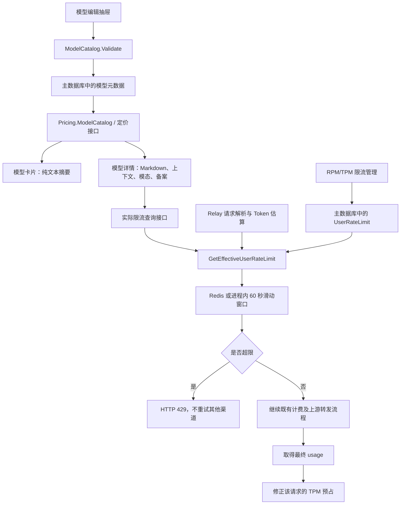

# 模型目录增强与六范围 RPM/TPM 限流完整方案

整理日期：2026-10-29。

本文汇总本轮对话在 new-api 默认前端及 Go 后端完成的改动，包括模型描述 Markdown、卡片摘要、上下文配置、模态与标签联动、模型备案、目录限流展示，以及六种范围的实际 RPM/TPM 限流。

本文不汇总后续独立的分组 Token 倍率、流式错误日志、日志筛选、ClickHouse 日志存储等工作区改动，也不修改现有配置。

## 1. 改动总览

| 功能 | 编辑或配置入口 | 展示或执行位置 | 核心行为 |
| --- | --- | --- | --- |
| 描述 Markdown | 模型编辑抽屉的描述输入框 | 模型详情页 | 复用已有 Markdown 组件，描述提示明确支持 Markdown |
| 卡片描述摘要 | 使用同一份模型描述 | 模型广场卡片 | 转成纯文本，避免原始语法符号和大标题样式 |
| 上下文信息 | 模型编辑抽屉 | 模型详情页 | 最大输入、最大输出、上下文窗口分别可留空 |
| 模态配置 | 模型编辑抽屉，位于标签下方 | 模型详情页 | 输入、输出分别图标多选，支持悬浮文字 |
| 快捷标签联动 | 文生图、文生视频、语音识别、语音合成 | 同一编辑抽屉 | 添加标签补齐模态，删除标签撤销其独有模态 |
| 模态高亮 | 输入、输出模态选择器 | 模型编辑抽屉 | 选中项使用主题色背景、边框与对比文字 |
| 模型备案 | 模型编辑抽屉 | 模型详情页 | 五项可分别留空，全空时隐藏整个区域 |
| 目录 RPM/TPM | 模型编辑抽屉 | 模型详情页 | 可手填展示值，也可选择显示当前用户的实际配置 |
| 六范围限流 | 系统设置 → 安全与限制 → RPM/TPM 限制 | Relay 请求链路 | 选择最高优先级的一条规则，逐用户滑动窗口计数 |
| 管理模型选择接口 | 限流管理页面自动请求 | 管理员接口 | 返回全站已启用能力中的模型名称，不受个人可用分组过滤 |

重要区分：模型目录中的上下文、模态、备案及手填 RPM/TPM 是展示元数据。它们不会自动改变上游模型能力、请求验证规则或实际限流。真正执行请求限流的是独立的 `UserRateLimit` 规则。

## 2. 总体架构



没有匹配规则，或匹配规则的 RPM、TPM 都为 `0` 时，不需要建立限流预占，直接继续既有流程。

## 3. 模型目录字段与持久化

### 3.1 字段定义

目录字段集中定义在 `ModelCatalog`，同时嵌入模型元数据和定价返回结构，避免编辑接口与公开目录使用两套不同字段。

| JSON 字段 | Go 类型 | 用途 | 空值及约束 |
| --- | --- | --- | --- |
| `max_input_tokens` | `*int` | 最大输入 Token 数 | `null` 表示未配置；非空为 1～2147483647 |
| `max_output_tokens` | `*int` | 最大输出 Token 数 | `null` 表示未配置；非空为 1～2147483647 |
| `context_length` | `*int` | 上下文窗口 | `null` 表示未配置；非空为 1～2147483647 |
| `rpm` | `*int` | 目录手填 RPM | `null` 未配置，`0` 不限，最大 2147483647 |
| `tpm` | `*int` | 目录手填 TPM | `null` 未配置，`0` 不限，最大 2147483647 |
| `show_actual_rate_limits` | `bool` | 是否显示实际限流配置 | 默认关闭 |
| `input_modalities` | `[]string` | 输入模态 | 空数组表示未配置 |
| `output_modalities` | `[]string` | 输出模态 | 空数组表示未配置 |
| `filing_region` | `string` | 备案属地 | 空字符串表示未配置 |
| `filing_model_name` | `string` | 备案中的模型名称 | 空字符串表示未配置，与网关模型名独立 |
| `filing_organization` | `string` | 备案单位 | 空字符串表示未配置 |
| `filing_number` | `string` | 备案号 | 空字符串表示未配置，按文本保存 |
| `filing_date` | `string` | 备案时间 | 空字符串表示未配置；非空为合法 YYYY-MM-DD 日期 |

最大输入、最大输出、上下文窗口是三个独立指标，不自动相加、推导或修改彼此，也不会据此自动修改 Relay 的 Token 校验上限。

### 3.2 存储与校验

- 输入、输出模态使用 GORM 的 JSON serializer，数据库列使用 `TEXT`，不依赖某一种数据库专有 JSON 类型。
- 五个备案字段使用 `TEXT`。日期也按文本保存，避免数据库日期类型差异。
- 备案字段在保存时去掉首尾空白；详情展示时也会再次去掉首尾空白。
- 日期用 Go 标准库校验，拒绝 `2026-02-30` 等不存在的日期，以及 `23/10/2026` 等非约定格式。
- 模态只允许 `text`、`image`、`audio`、`video`，拒绝未知或重复值。
- 模型创建与完整更新均调用目录校验。
- 模型更新使用显式 `Select` 更新目录字段，因此 `null`、空字符串、空数组以及 `false` 都能真正覆盖旧值。
- 字段由后端启动时的 GORM 自动迁移创建，设计沿用 SQLite、MySQL、PostgreSQL 兼容方式。

### 3.3 编辑、回填与清空

编辑抽屉为所有新字段提供默认值，读取模型时回填已有配置。保存时新字段随模型数据提交，不需要另建备案或模态保存接口。

完整模型更新不是局部 PATCH。直接调用更新接口时，应保留未修改的模型字段；遗漏目录字段可能按空值更新。只更新状态应使用既有的 `status_only=true` 分支，该分支不会清空其他信息。

模型目录配置示例，非真实备案数据：

```json
{
  "id": 123,
  "model_name": "example-model",
  "description": "# 模型说明\n\n支持文本输入和图片输出。",
  "icon": "",
  "tags": "文生图",
  "vendor_id": 0,
  "endpoints": "",
  "name_rule": 0,
  "status": 1,
  "sync_official": 0,
  "max_input_tokens": 128000,
  "max_output_tokens": 8000,
  "context_length": 136000,
  "rpm": null,
  "tpm": null,
  "show_actual_rate_limits": true,
  "input_modalities": ["text"],
  "output_modalities": ["image"],
  "filing_region": "上海",
  "filing_model_name": "示例备案模型",
  "filing_organization": "示例备案单位",
  "filing_number": "",
  "filing_date": "2026-10-23"
}
```

## 4. 模型描述与卡片摘要

### 4.1 详情页完整 Markdown

模型详情页复用现有 `Markdown` 组件，不新增渲染依赖。该组件使用 `marked` 解析，并通过 DOMPurify 清理 HTML。

支持标题、强调、列表、链接、代码块、表格等已有 Markdown 能力。完整能力以全局 Markdown 组件为准，本轮没有另建一套解析规则。

详情描述沿用原有优先级：模型自身描述优先，供应商描述作为兜底；两者都为空时不渲染描述。编辑框提示改为“描述此模型... 支持 Markdown。”，并同步各语言。

### 4.2 卡片为什么不直接渲染 Markdown

模型广场卡片需要紧凑、稳定的摘要。直接插入 Markdown 的一级标题、列表或表格，会导致字体、块级间距和卡片高度与摘要布局不匹配。

因此卡片使用 `getModelDescriptionPreview`：

1. 用 `marked` 解析模型描述。
2. 用 DOMPurify 清理 HTML，并禁用 `script`、`style` 标签。
3. 放入不挂载到可见页面的 `template`。
4. 将图片替换为图片的 `alt` 说明。
5. 在段落、标题、列表项、代码块、引用、表格行和换行等边界补充空白。
6. 提取 `textContent`，将连续空白折叠为一个空格。
7. 以 React 纯文本方式显示，不把生成的 HTML 作为卡片内容渲染。

该流程使用已有的 `marked` 和 DOMPurify，不调用模型生成摘要，也不新增依赖。解析使用浏览器 DOM；相关测试需要浏览器或 DOM 环境。

示例：

```markdown
# 示例模型

支持 **文本理解** 和 [图片分析](https://example.com)。

- 支持多轮对话
- 支持代码处理
```

卡片文字为：

```text
示例模型 支持 文本理解 和 图片分析。 支持多轮对话 支持代码处理
```

标题文字保留，但不应用标题样式，也不自动跳过标题或挑选某一段正文。代码中的 `model_name`、`C#`、`2 * 3` 等合法符号不会被简单正则统一删除。

卡片沿用移动端一行、桌面两行截断。模型自身描述为空，或解析后没有文字时，显示既有的“暂无描述”。卡片不额外使用供应商描述兜底。

## 5. 模态、快捷标签与选中高亮

### 5.1 配置和展示

模态配置位于标签下方，输入、输出分别多选，支持文字、图片、音频、视频。界面使用图标，并通过 i18n 显示悬浮文字；详情图标也保留可访问名称和键盘焦点入口。

选中的编辑按钮使用 `aria-pressed` 状态应用主题色背景、主题色边框和对比文字，悬浮时保持选中配色。不修改其他页面的全局 Toggle 样式。

### 5.2 四个快捷标签的映射

| 快捷标签 | 自动补齐输入 | 自动补齐输出 |
| --- | --- | --- |
| 文生图 | `text` | `image` |
| 文生视频 | `text` | `video` |
| 语音识别 | `audio` | `text` |
| 语音合成 | `text` | `audio` |

快捷按钮和标签输入框的增删统一进入 `handleTagsChange`，而不是仅在快捷按钮点击时追加模态。

### 5.3 增删算法与边界

- 对新标签集合去重，比较旧集合与新集合，得到新增、删除和仍保留的快捷标签。
- 新增快捷标签只补齐其对应的模态，不重复加入相同类型。
- 删除快捷标签时，删除它对应、且不再被其他剩余快捷标签依赖的模态。
- 其他不相关的手动模态保留。
- 重复点击同一快捷按钮是去重追加，不是取消；取消通过标签输入框的删除操作完成。
- 直接输入或删除同名快捷标签，也走相同的联动逻辑。
- 后端只保存最终模态数组，不额外保存模态来自哪个标签的来源记录。

典型行为：

| 操作 | 结果 |
| --- | --- |
| 添加文生图 | 输入补齐文本，输出补齐图片 |
| 删除文生图，再添加文生视频 | 撤销图片输出，补齐视频输出 |
| 同时有文生图、文生视频，再删除文生图 | 图片输出取消，文本输入和视频输出保留 |
| 手动选择视频输入，再增删文生图 | 不相关的视频输入保留 |

这里采用集合联动：与被删除标签完全对应的类型，若没有剩余快捷标签依赖，会被撤销；没有服务端来源字段用于区分同一类型的“手工选择”和“标签自动选择”。

## 6. 模型备案的显示规则

编辑页始终提供五个可选输入：属地、模型名称、备案单位、备案号、备案时间。备案时间使用日期输入框。

详情页逐项过滤空值后生成区域：

| 配置情况 | 展示结果 |
| --- | --- |
| 只填写模型名称、备案单位 | 仅显示这两项，不显示其他项目或占位符 |
| 只填写备案号 | 仅显示备案号 |
| 五项填全 | 全部显示 |
| 五项都为空或只含空白 | 整个“模型备案”区域隐藏 |
| 清空已有值并保存 | 对应旧值被清空，详情不再显示 |

备案名称 `filing_model_name` 与网关模型标识 `model_name` 分开保存，允许官方备案名称与公开调用别名不同。备案号按字符串保存，保留前导零等内容。

备案信息是管理员填写的展示数据，不包含外部备案查询、真实性核验或自动认证流程。详情值允许换行布局，不使用截断隐藏完整的单位名称或备案号。

## 7. 模型详情的限流展示

### 7.1 手填值与实际值

| 配置 | 详情行为 |
| --- | --- |
| 关闭实际配置，RPM/TPM 均未填 | 隐藏限流区域 |
| 关闭实际配置，只填一项 | 显示手填值，另一项显示未配置 |
| 手填 `0` | 对应项显示不限 |
| 开启实际配置，已登录 | 查询当前用户实际生效的 RPM/TPM |
| 开启实际配置，未登录 | 提示登录后查看，不展示其他用户的值 |
| 实际配置查询中 | 显示加载状态 |
| 实际配置查询失败 | 显示失败提示与重试操作，不回退到手填值 |
| 没有实际匹配规则 | 查询结果为 RPM=0、TPM=0，显示不限 |

开启实际配置时，编辑页的手填 RPM/TPM 输入禁用，但不主动删除此前保存的手填值。关闭后可继续使用手填展示值。

再次强调：在模型编辑页填入 RPM/TPM，不会创建实际限流规则；实际规则必须在限流管理页配置。

### 7.2 K/M 数值格式

RPM、TPM、最大输入、最大输出、上下文窗口共用 `formatCatalogTokenCount`，按原始数值选择单位，最多一位小数：

| 数值 | 显示 |
| --- | --- |
| 999 | 999 |
| 1000 | 1K |
| 1500 | 1.5K |
| 128000 | 128K |
| 1000000 | 1M |
| 2500000 | 2.5M |

未配置与不限状态在格式化之前单独处理，不把 `0` 格式化为 `0K`。数字格式沿用浏览器环境的 Intl 行为。

## 8. 六种范围的实际限流

### 8.1 范围和规范化键

| 范围 | `scope` | 必填目标 | 规范化后的其他字段 |
| --- | --- | --- | --- |
| 全局默认 | `global` | 无 | user_id=0，用户名、用户组、模型名为空 |
| 用户组 | `group` | group_name | user_id=0，用户名、模型名为空 |
| 用户 | `user` | 有效 user_id | 用户组、模型名为空，用户名由数据库获取 |
| 模型 | `model` | model_name | user_id=0，用户名、用户组为空 |
| 用户组与模型 | `group_model` | group_name、model_name | user_id=0，用户名为空 |
| 用户与模型 | `user_model` | 有效 user_id、model_name | 用户组为空，用户名由数据库获取 |

配置 RPM/TPM 均为 0～2147483647 的整数。范围、用户组和模型名按既有规范去除首尾空白；不接受未支持的范围。

用户组按账户所属组匹配，不按 API Key 分组或渠道分组匹配。限流模型名按规范化后的请求原始模型名称精确匹配，不使用模型目录的 `name_rule` 前缀、包含或后缀规则。

### 8.2 最终优先级

```text
用户 + 模型 > 用户组 + 模型 > 模型 > 用户 > 用户组 > 全局默认
```

这是本轮明确确认的六层顺序。模型规则优先于用户和用户组的通用规则。

每次只选一条最高优先级匹配规则，RPM、TPM 都从这条规则读取，不叠加其他层，也不分别从不同层继承两个维度。

`0` 是明确的不限配置，不是“向下继承”。例如用户通用 TPM=50000，但模型规则 TPM=0，且没有更高优先级规则时，该模型请求不限 TPM。

全局默认也不是硬上限：更高优先级规则可以放宽或收紧它。若业务需要全局硬上限或逐层取最小值，需要另行改变语义，不能把当前方案解释为累加限制。

### 8.3 六层示例

假设同时有以下规则：

| 范围 | 目标 | RPM | TPM |
| --- | --- | --- | --- |
| global | 所有用户 | 100 | 100000 |
| group | premium | 200 | 200000 |
| user | alice | 50 | 50000 |
| model | gpt-test | 80 | 120000 |
| group_model | premium + gpt-test | 20 | 20000 |
| user_model | alice + gpt-test | 10 | 0 |

| 请求 | 生效范围 | RPM / TPM |
| --- | --- | --- |
| premium 的 alice 请求 gpt-test | user_model | 10 / 不限 |
| premium 的 bob 请求 gpt-test | group_model | 20 / 20000 |
| default 的 charlie 请求 gpt-test | model | 80 / 120000 |
| alice 请求其他模型 | user | 50 / 50000 |
| premium 的 bob 请求其他模型 | group | 200 / 200000 |
| default 的 charlie 请求其他模型 | global | 100 / 100000 |

逐层删除最高优先级规则后，回退顺序同上；全部没有匹配规则时不限。

### 8.4 单次查询与索引

规则沿用唯一索引 `(scope, user_id, group_name, model_name)`。新增两种范围不需要新增表、列或调整此索引。

`GetEffectiveUserRateLimit` 构造六种范围的规范化完整键条件，合并为一次查询，用标准 SQL `CASE scope` 排序后取第一条：

| scope | 排序权重 |
| --- | --- |
| user_model | 0 |
| group_model | 1 |
| model | 2 |
| user | 3 |
| group | 4 |
| global | 5 |

完整键条件补齐无关字段的 0/空字符串，有利于使用已有唯一索引，避免逐层进行最多六次数据库查询。条件中的用户、用户组和模型名通过参数绑定传入。

没有记录返回 `nil`；数据库错误向调用方返回，不把查询失败解释为正常不限。

## 9. 60 秒窗口与 TPM 预占结算

### 9.1 计数范围

所有六种规则均逐用户计数，键保持：

```text
userRateLimit:{scope}:{ruleID}:{userID}
```

“模型 RPM=100”表示每个使用该模型的用户分别最多 100 RPM，不表示所有用户共享一个模型总配额。用户组与模型也不是组内共用配额。

只对选中的规则计数，不把同一个请求记入所有低优先级规则。

### 9.2 请求判定

1. 请求解析和校验后获取原始模型名、用户 ID、账户用户组。
2. 使用既有 Token 估算结果，取得该请求的预占 Token 数。
3. 选择最高优先级规则。
4. 清理超过 60 秒窗口的请求记录。
5. 若 RPM>0 且已有请求数达到上限，拒绝本次请求。
6. 若 TPM>0 且已有 Token 数加本次预估值超过上限，拒绝本次请求。
7. 未超限则预占一次请求与预估 Token，继续既有计费和转发流程。
8. 取得最终 usage 后，以消费日志入口使用的实际 prompt_tokens + completion_tokens 修正该请求的 Token 预占。

两个维度同时配置时必须同时满足；若都超限，当前先判 RPM，拒绝原因记录为 `rpm`。Token 数恰好等于 TPM 上限时允许。

缺失上游 usage 的请求继续使用既有消费日志链路的回退口径。TPM 修正按请求 ID 替换原记录，不增加一次请求计数，也不调整本次费用。

### 9.3 Redis 与内存模式

| 模式 | 原子性与状态 |
| --- | --- |
| Redis | Lua 原子完成窗口清理、判定和预占；第二个 Lua 按请求 ID 修正 Token 数；键设置 120 秒过期 |
| 无 Redis | 进程内 map 与互斥锁保证单进程原子性；请求判定时清理窗口，结算时修改对应记录 |

多实例应使用同一 Redis 才能共享同一用户的计数；无 Redis 时各实例独立。Redis 模式仍使用应用传入的时间戳，多实例时应保持服务器时钟同步。

### 9.4 拒绝结果

超限发生在上游转发之前，返回 HTTP 429，沿用错误信息“请求频率或 token 使用量超过限制”，并设置跳过重试标记，不把限流错误当作上游渠道故障重试。

## 10. API 与权限

### 10.1 模型目录接口

| 方法 | 路径 | 用途 |
| --- | --- | --- |
| GET | /api/models/ | 管理模型列表 |
| GET | /api/models/:id | 编辑模型时读取完整元数据 |
| POST | /api/models/ | 创建模型及目录字段 |
| PUT | /api/models/ | 完整更新模型及目录字段 |
| GET | /api/pricing | 提供模型目录、价格和关联元数据 |
| GET | /api/pricing/rate-limits?model=模型名 | 获取当前登录用户的实际 RPM/TPM |

模型管理沿用管理员权限。定价和实际限流查询同时遵循既有模型广场模块访问策略。

实际限流查询必须登录，只允许查询当前用户可用、且开启实际配置展示的模型；不支持通过参数指定其他用户。仅返回 RPM/TPM，不返回规则 ID、用户名等管理信息。

实际查询结果示例：

```json
{
  "success": true,
  "message": "",
  "data": { "rpm": 1500, "tpm": 1000000 }
}
```

实际查询缺少模型参数时返回 400，不存在可展示模型时返回 404；登录失效按认证中间件处理。

### 10.2 限流管理接口

以下接口统一沿用管理员权限：

| 方法 | 路径 | 用途 |
| --- | --- | --- |
| GET | /api/user_rate_limit/ | 分页列出规则，支持 keyword、p、page_size |
| POST | /api/user_rate_limit/ | 创建规则，相同规范化键更新已有规则 |
| PUT | /api/user_rate_limit/:id | 编辑指定规则，检查目标键冲突 |
| DELETE | /api/user_rate_limit/:id | 删除规则 |
| GET | /api/user_rate_limit/models | 返回全站已启用能力中的去重模型名称 |

模型名称接口不受管理员个人可用分组过滤，只查询已启用能力并返回模型名，不返回渠道和密钥信息。它与限流 CRUD 使用相同的管理员权限，不要求额外读取渠道详情。

POST/PUT 示例分别提交，不是批量接口：

```json
{
  "scope": "model",
  "user_id": 0,
  "group_name": "",
  "model_name": "gpt-test",
  "rpm": 100,
  "tpm": 100000
}
```

```json
{
  "scope": "group_model",
  "user_id": 0,
  "group_name": "premium",
  "model_name": "gpt-test",
  "rpm": 30,
  "tpm": 20000
}
```

```json
{
  "scope": "user_model",
  "user_id": 1001,
  "group_name": "",
  "model_name": "gpt-test",
  "rpm": 10,
  "tpm": 0
}
```

管理接口沿用项目的 `success/message/data` 业务响应。不能仅凭 HTTP 200 判定配置成功，客户端必须检查 `success`；输入错误和冲突可能以 HTTP 200、success=false 返回。

## 11. 管理页面与缓存

实际限流管理入口为 `/system-settings/security/rpm-tpm-limits`。

- 应用范围下拉支持全部六项。
- 用户范围选择用户；用户组范围选择用户组；模型范围直接选择模型。
- 用户+模型和用户组+模型范围分别提供目标与模型选择框。
- 切换范围时清理无关目标字段，保留该范围仍适用的值，避免编辑复合规则时清空用户组或模型。
- 保存前校验必选目标，以及 RPM/TPM 的非负整数和 int32 上限。
- 表格展示范围、目标、模型、RPM、TPM，并沿用编辑、删除操作。
- 用户、用户组选项读取既有管理接口；模型选项读取新的限流专用名称接口。
- 用户、用户组、模型选项沿用 5 分钟前端缓存。
- 规则列表接口分页；前端当前请求第一页并传入 page_size=1000，实际页大小仍以服务端处理为准。

模型目录保存后，前端使模型列表、pricing、pricing-rate-limits 和相关配置查询失效；服务端模型保存路径也刷新定价缓存。服务端定价元数据沿用既有约 1 分钟缓存，前端定价查询沿用约 5 分钟 staleTime。

实际限流查询使用包含用户 ID、用户组与模型名的独立 query key，staleTime 为 1 分钟。结果不写入共享定价缓存，不把一个用户的实际配置当作所有用户的目录值。

限流规则解析本轮没有新增规则缓存，Relay 与实际配置接口共用同一个解析函数。

## 12. 国际化

覆盖英语、简体中文、繁体中文、法语、日语、俄语、越南语。

新增文案包括 Markdown 描述提示、最大输入、上下文窗口、模型限流、实际配置状态、模型备案与五个备案字段，以及用户组与模型范围名称。模态、模型、用户等标签复用现有翻译键。

Locale 文件不手工编辑；通过既有脚本写入，再执行 i18n 同步：

```bash
cd web/default
bun scripts/add-missing-keys.mjs --model-catalog
bun scripts/add-missing-keys.mjs --model-filing
bun scripts/add-missing-keys.mjs --rate-limit-scopes
bun run --bun i18n:sync
```

这些范围参数用于只更新对应文案，避免执行本轮翻译时覆盖其他独立工作的翻译。

## 13. 存储、兼容与部署

### 13.1 数据库和 Redis

- 模型目录和 UserRateLimit 规则都使用主数据库 `model.DB`，不是独立日志数据库。
- 新增目录字段需要运行包含当前代码的后端，才能由 GORM 自动迁移创建。
- 六种限流范围沿用原表和唯一索引，没有额外表或列迁移。
- 模态和备案使用 TEXT，规则匹配使用标准条件与 CASE，设计兼容 SQLite、MySQL、PostgreSQL。
- 实施阶段的数据库回归主要运行于 SQLite；这不等于已在所有生产数据库版本实测。
- 多实例需要一致的主数据库配置与共享 Redis；保持服务器时间同步。

### 13.2 生效步骤

1. 备份主数据库并记录当前运行版本。
2. 构建默认前端，将新产物纳入后端打包或前端部署。
3. 重新构建并重启后端，检查自动迁移和服务启动结果。
4. 容器部署应发布包含新代码和前端产物的新镜像；只重启旧镜像不会加载源码改动。
5. 使用管理员账户确认模型编辑字段和六范围选项。
6. 保存测试模型，确认详情与卡片展示。
7. 创建限流测试规则，使用普通用户确认实际配置和 HTTP 429 行为。
8. 验证后删除或恢复测试配置。

已有四种范围的规范化有效规则，在没有匹配的新高优先级规则时维持原有行为。旧版本后端不会识别新增范围，所以不能只部署前端而继续运行旧后端。

本轮没有新增日志数据库或 ClickHouse TTL 配置要求；相关配置属于独立工作，不因本文功能而需要更改。

## 14. 验证记录与复现命令

本节记录前面实施阶段的检查结果，不是对 2026-10-29 当前整个工作区重新跑测试的声明。本次仅整理文档；工作区还有本轮范围外的后续改动。

### 14.1 实施阶段已通过的检查

| 检查 | 验证内容 |
| --- | --- |
| TestModelCatalogPersistenceAndClearing | 目录、模态、备案字段保存和清空 |
| TestModelCatalogFilingNormalization | 首尾空白规范化与空日期 |
| TestModelCatalogValidation | 数值边界、模态校验、非法日期 |
| TestGetEffectiveUserRateLimitPrefersSpecificScope | 六层优先级、逐层回退、不同用户/用户组/模型、零值覆盖 |
| TestNewUserRateLimitScopesNormalizeAndUpsert | 新范围规范化、保存、更新及缺失目标拒绝 |
| TestNewUserRateLimitScopesKeepUserCountersSeparate | 两个新范围的逐用户计数隔离 |
| TestPricingCatalogAndEffectiveRateLimits | 目录元数据透传与实际限流查询优先级一致 |
| TestUserRateLimitModelsIncludesAllGroups | 跨分组模型选择、去重和禁用能力过滤 |
| 既有 RPM/TPM 测试 | RPM 拒绝原因、TPM 预估替换实际 usage、无规则放行 |
| 前端生产构建 | 新页面、字段、接口和翻译可完成打包 |
| 浏览器模拟接口验证 | 编辑回填、清空提交、标签联动、K/M、备案过滤、六范围创建和切换 |
| 移动端检查 | 摘要一行、目录与限流配置区域无整体横向溢出 |

浏览器测试采用模拟接口和临时登录状态，未向真实数据库保存测试模型或限流规则，测试后清理了模拟状态。

### 14.2 浏览器关键验收项

| 场景 | 期望 |
| --- | --- |
| Markdown 含一级标题、强调、链接、列表 | 详情完整渲染；卡片只显示纯文本 |
| 描述只含空格式、无文字 | 卡片显示暂无描述 |
| 描述含代码符号和图片 | 保留代码文字；摘要用图片 alt，不插入图片 |
| 删除文生图再选文生视频 | 撤销图片输出，选择视频输出 |
| 两个标签共享文本输入 | 删除其中一个仍保留文本 |
| 已选模态 | 主题色底色和对比文字明显不同于未选中项 |
| 鼠标放到详情模态图标 | 显示对应文字 |
| RPM=1500、TPM=2500000 | 显示 1.5K、2.5M |
| 备案只填名称、单位 | 仅显示两项 |
| 备案全空或纯空白 | 整个区域隐藏 |
| 清空既有备案值 | 提交空字符串，保存后不再展示 |
| 创建 group_model | 提交用户组、模型，user_id=0 |
| group_model 切换到 model | 清理用户组和用户 ID，保留模型 |
| 新范围选择模型 | 能选择个人可用分组之外的已启用模型名 |

### 14.3 可复现命令

```bash
go test ./model -run 'TestModelCatalog' -count=1

go test ./router ./model ./controller \
  -run 'TestGetEffectiveUserRateLimitPrefersSpecificScope|TestNewUserRateLimitScopes|TestPricingCatalogAndEffectiveRateLimits|TestUserRateLimitModelsIncludesAllGroups|TestUserRateLimitSettlesEstimatedTokensWithActualUsage|TestUserRateLimitReturnsRPMReason|TestNilUserRateLimitAllowsRequest' \
  -count=1

cd web/default
bun run typecheck
bun x --bun oxlint -c .oxlintrc.json \
  src/features/models/components/drawers/model-mutate-drawer.tsx \
  src/features/pricing/components/model-card.tsx \
  src/features/pricing/components/model-details.tsx \
  src/features/pricing/lib/model-description.ts \
  src/features/system-settings/request-limits/user-rate-limit-section.tsx \
  src/features/system-settings/request-limits/user-rate-limit-api.ts
bun run build
```

实施阶段全量 typecheck 曾被 13 处原有错误阻塞，模型详情文件也有原有 lint 问题；本轮没有扩大范围修复这些问题。该数量是当时记录，不能视作当前工作区状态。发布时应重新执行检查，按当前结果处理。

## 15. 主要实现文件

以下链接相对于本文所在 docs 目录：

| 文件 | 作用 |
| --- | --- |
| [../model/model_catalog.go](../model/model_catalog.go) | 目录、模态、备案字段与校验 |
| [../model/model_meta.go](../model/model_meta.go) | 模型创建、更新与零值清空 |
| [../model/pricing.go](../model/pricing.go) | 目录字段透传到定价数据 |
| [../controller/model_meta.go](../controller/model_meta.go) | 模型管理请求入口 |
| [../controller/pricing.go](../controller/pricing.go) | 目录及当前用户实际限流查询 |
| [../model/user_rate_limit.go](../model/user_rate_limit.go) | 六范围规范化、单查询匹配、预占与结算 |
| [../controller/user_rate_limit.go](../controller/user_rate_limit.go) | 规则管理和管理员模型名称接口 |
| [../controller/relay.go](../controller/relay.go) | Relay 限流接入 |
| [../model/log.go](../model/log.go) | 实际 usage 的 TPM 修正入口 |
| [../router/api-router.go](../router/api-router.go) | 路由和权限绑定 |
| [../web/default/src/features/models/components/drawers/model-mutate-drawer.tsx](../web/default/src/features/models/components/drawers/model-mutate-drawer.tsx) | 模型配置、标签与模态联动 |
| [../web/default/src/features/models/types.ts](../web/default/src/features/models/types.ts) | 管理模型字段类型 |
| [../web/default/src/features/pricing/types.ts](../web/default/src/features/pricing/types.ts) | 公开目录字段类型 |
| [../web/default/src/features/pricing/components/model-details.tsx](../web/default/src/features/pricing/components/model-details.tsx) | Markdown、上下文、模态、备案、实际限流展示 |
| [../web/default/src/features/pricing/components/model-card.tsx](../web/default/src/features/pricing/components/model-card.tsx) | 卡片摘要接入 |
| [../web/default/src/features/pricing/lib/model-description.ts](../web/default/src/features/pricing/lib/model-description.ts) | Markdown 纯文本摘要 |
| [../web/default/src/features/pricing/api.ts](../web/default/src/features/pricing/api.ts) | 目录与实际限流前端 API |
| [../web/default/src/features/pricing/hooks/use-pricing-data.ts](../web/default/src/features/pricing/hooks/use-pricing-data.ts) | 目录数据与缓存 |
| [../web/default/src/features/system-settings/request-limits/user-rate-limit-section.tsx](../web/default/src/features/system-settings/request-limits/user-rate-limit-section.tsx) | 六范围配置页面 |
| [../web/default/src/features/system-settings/request-limits/user-rate-limit-api.ts](../web/default/src/features/system-settings/request-limits/user-rate-limit-api.ts) | 管理请求与范围类型 |
| [../web/default/src/features/system-settings/security/section-registry.tsx](../web/default/src/features/system-settings/security/section-registry.tsx) | 配置页面入口注册 |
| [../web/default/src/components/ui/markdown.tsx](../web/default/src/components/ui/markdown.tsx) | 已有 Markdown 渲染器 |
| [../web/default/scripts/add-missing-keys.mjs](../web/default/scripts/add-missing-keys.mjs) | 范围化翻译写入脚本 |
| [../model/model_catalog_test.go](../model/model_catalog_test.go) | 模型目录回归 |
| [../model/user_rate_limit_test.go](../model/user_rate_limit_test.go) | 限流规则与窗口回归 |
| [../controller/model_list_test.go](../controller/model_list_test.go) | 目录、实际限流和模型名称接口回归 |

限流专项说明另见 [用户级tpm与rpm实现方案.md](用户级tpm与rpm实现方案.md)。本文作为本轮全部功能的统一汇总，专项文档用于展开限流本身。

## 16. 实施与运维边界

1. 展示元数据不等于真实模型能力、备案认证或限流策略。
2. 六层范围是覆盖关系，不是累加，也不是独立继承 RPM 与 TPM。
3. 模型、用户组与模型的配额也逐用户计算，不是共享模型或共享组配额。
4. 标签联动按集合处理，保存最终结果，不新增模态来源数据库字段。
5. 目录匹配的 name_rule 与实际限流的精确模型名匹配是两套不同规则。
6. 实际配置查询只针对当前用户，不能把结果写入公共目录缓存。
7. 管理模型名称接口反映已启用能力中的名称，不额外保证上游实时可达。
8. 修改或删除规则可能让请求切换到其他规则 ID 或范围的窗口；本轮没有增加跨规则迁移历史计数机制。
9. 整体仓库的后续计费、日志、存储等改动不在本文范围，不能据本文的历史验证记录判断其发布状态。